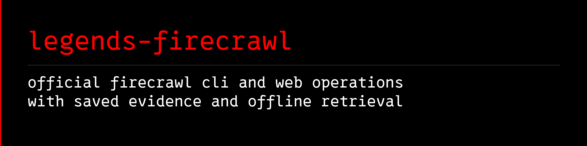
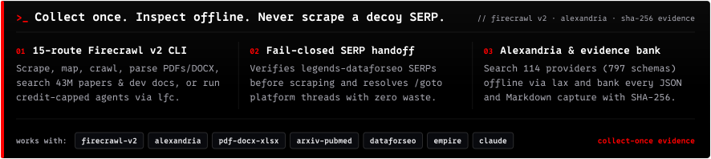
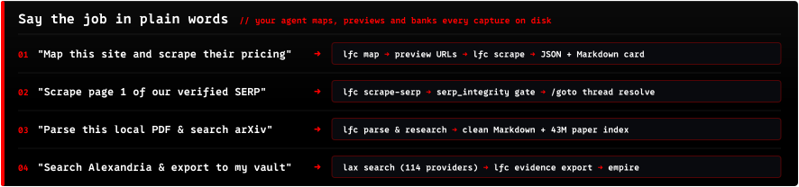
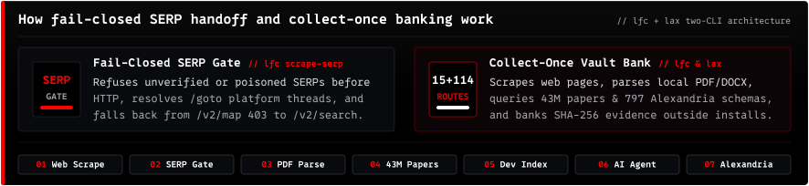
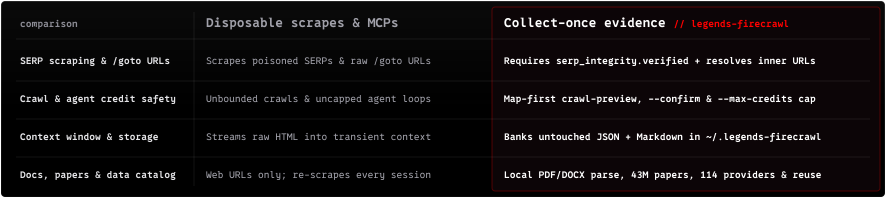

# 

[](https://github.com/avalonreset/legends-firecrawl/releases/latest)
[](https://github.com/avalonreset/legends-firecrawl/actions/workflows/contract.yml)
[](pyproject.toml)
[](package.json)
[](python/legends_firecrawl/routes.json)
[](LICENSE)

**Firecrawl v2 and Alexandria CLI engine (`lfc` and `lax`) for coding agents: scrape, map, crawl, parse local PDFs and Office docs, search 43M research papers and 114 Alexandria data providers, enforce fail-closed SERP verification with `/goto` platform resolution, and bank every response on disk with SHA-256 provenance.**


```text
Install or update legends-firecrawl via cto-legends (https://github.com/avalonreset/cto-legends): run `cto-legends install legends-firecrawl --apply`, then `cto-legends handoff legends-firecrawl` and follow the returned JSON recipe to verify `lfc` and `lax`.
```



## Why `legends-firecrawl` exists

Most agent scraping setups treat web extraction as disposable chat output:

1. **Streaming raw HTML or Markdown into the context window:** An ambient daemon dumps a 40 KB scrape straight into your active conversation. Five minutes later, when your agent needs a second section from the same URL or you start a new session, it has to pay for and re-scrape the page all over again.
2. **Scraping decoy SERPs and opaque `google.com/goto` wrappers:** When an upstream search tool pulls an unverified SERP or returns Google's `google.com/goto?url=...` redirect wrappers, a naive scraper either wastes credits scraping poisoned URLs or hits Google's interstitial redirect wall instead of the real inner thread.
3. **Unbounded recursive crawls and uncapped extraction loops:** Turning an agent loose on `/v2/crawl` or `/v2/agent` without a map-first preview, explicit confirmation gate, or hard credit ceiling can burn hundreds of credits in a single background loop.

`legends-firecrawl` pairs two focused CLIs (`lfc` for the 15-route Firecrawl v2 catalog and `lax` for the 114-provider Alexandria data catalog) behind a **collect-once, inspect-offline** architecture. Every live response is archived as untouched JSON (`var/captures/firecrawl/`) plus a Markdown vault card (`vault/captures/firecrawl/`) under `~/.legends-firecrawl/research` so your coding agent can inspect, slice, and verify saved captures offline without spending another credit.

## Ask in plain english

Once [`cto-legends`](https://github.com/avalonreset/cto-legends) is installed, you ask your coding agent in plain english. It maps the site or previews the route first, enforces credit caps and SERP integrity gates, and banks the capture on disk:



## Architecture: fail-closed SERP gate and collect-once banking



### 1. Fail-closed SERP integrity gate and `/goto` platform resolution (`lfc scrape-serp`)

When chaining search rankings from [`legends-dataforseo`](https://github.com/avalonreset/legends-dataforseo) into page-level Markdown extraction, `lfc scrape-serp` enforces two strict safety layers before making a single HTTP scrape call:

- **Decoy SERP refusal (`serp_integrity.verified: true`):** `lfc scrape-serp` inspects the saved SERP envelope and refuses to scrape if `serp_integrity.verified` is missing or `false`, or if any organic block is flagged `suspect_decoy`, `suspect_poisoned`, `unverified_decoy`, `unresolved`, or `unprotected`. Your agent never burns Firecrawl credits scraping a poisoned SERP.
- **Zero-credit homepage short-circuit and `/goto` thread resolution (`--resolve-goto`):** When Google wraps organic SERP links in `google.com/goto?url=...`, `lfc` inspects the item's `breadcrumb` and `website_name`. Bare domain breadcrumbs (`https://www.example.com`) short-circuit directly to the canonical homepage for **0 extra map credits**. Social and community threads with engagement breadcrumbs (`Reddit · r/Phoenixville` or `30+ reactions`) resolve through a closed 13-platform allowlist (`WEBSITE_NAME_PLATFORMS`: Reddit, YouTube, Facebook, Instagram, X/Twitter, LinkedIn, TikTok, Yelp, Nextdoor, Quora, Pinterest, Tripadvisor, Medium) with `require_candidate=True` so failed resolution raises `SafetyError` instead of silently scraping a bare platform homepage, and automatically falls back from `/v2/map` HTTP 403 blocks to `/v2/search` (`site:<domain>`).

### 2. The 15-route Firecrawl v2 CLI (`lfc`)

Every route in `python/legends_firecrawl/routes.json` maps to a deterministic `lfc` subcommand with `--dry-run`, `--confirm`, SSRF redirect/proxy hardening (`_NoRedirect`, public-IP DNS verification), and automatic local capture banking:

| Surface | `lfc` Subcommands | What It Does |
| :--- | :--- | :--- |
| **Web Extraction & Discovery** | `scrape`, `map`, `search`, `resolve`, `scrape-serp` | Clean Markdown/JSON extraction (`/v2/scrape`), fast URL discovery (`/v2/map`), web search (`/v2/search`), breadcrumb-to-URL resolution (`resolve`), and fail-closed SERP batch scraping (`scrape-serp`). |
| **Bounded Site Crawling** | `crawl-preview`, `crawl`, `crawl-status` | Zero-cost scope preview (`crawl-preview`) followed by depth- and page-bounded crawling (`/v2/crawl` with `--limit`, `--max-depth`, and mandatory `--confirm`). |
| **Local Document Parsing** | `parse` | Multipart local document upload (`/v2/parse`) converting local `PDF`, `DOCX`, `DOC`, `XLSX`, `XLS`, `ODT`, `RTF`, and `HTML` files into clean Markdown and structured links with symlink refusal. |
| **43M Research Papers & Dev Index** | `research`, `developer` | Search ~43M academic papers across arXiv, PubMed, bioRxiv, and medRxiv (`/v2/search/research/papers` plus `inspect`, `related`, `read`, `github` modes) and query Firecrawl's curated developer documentation index (`/v2/search/developer`). |
| **Credit-Capped AI Agent & Monitors** | `agent`, `agent-status`, `interact`, `monitor`, `search-feedback` | Autonomous extraction agent (`/v2/agent`) gated by a mandatory `--max-credits` ceiling, interactive page sessions (`/v2/scrape/{id}/interact`), scheduled page-change monitors (`/v2/monitor`), and search rating feedback (`/v2/search/{id}/feedback`). |

### 3. Alexandria 114-provider catalog (`lax`) and SHA-256 evidence bank (`lfc evidence`)

- **Offline catalog discovery & preview-first queries (`lax`):** Search 114 structured data providers and 797 capabilities offline (`lax search`, `lax inspect <provider> --full`, `lax audit`). Every `lax query` defaults to a zero-charge preview (`--preview`); live submission requires explicit `--confirm`.
- **External SHA-256 evidence bank (`~/.legends-firecrawl/research`):** Captures are stored outside replaceable module checkouts so upgrading `legends-firecrawl` never overwrites your research archive. Use `lfc evidence inventory`, `find`, `view`, `reuse`, `export-capture`, and `verify` to check exact-scope freshness before re-querying or to hand off a verified evidence package into [`legends-empire`](https://github.com/avalonreset/legends-empire).

## Disposable scrapes vs `legends-firecrawl`



## Quick start

```sh
# 1. Check account credits and runtime health
lfc doctor --offline
lfc credits

# 2. Map a domain first, then scrape or resolve specific inner pages
lfc map https://example.com --limit 100
lfc scrape https://example.com
lfc resolve "https://example.com" --path-hint "pricing" --scrape

# 3. Scrape page 1 of a verified legends-dataforseo SERP (refuses decoy SERPs fail-closed)
lfc scrape-serp serp.json --limit 10 --resolve-goto --confirm

# 4. Parse local PDFs/DOCX, search 43M research papers, or query developer docs
lfc parse ./report.pdf --formats markdown,links --dry-run
lfc research "CRISPR base editing off-target effects" --limit 10 --dry-run
lfc developer "axum middleware ordering" --limit 10 --dry-run

# 5. Preview and run a bounded crawl or credit-capped extraction agent
lfc crawl-preview https://example.com --limit 25 --max-depth 2
lfc crawl https://example.com --limit 25 --max-depth 2 --confirm
lfc agent "Extract pricing tiers" --urls https://example.com/pricing --max-credits 25 --dry-run

# 6. Search the 114-provider Alexandria catalog offline, preview, and confirm
lax search "treasury"
lax inspect treasury-fiscal-data
lax query treasury-fiscal-data debt/to-the-penny
lax query treasury-fiscal-data debt/to-the-penny --confirm
```

## Reference

<details>
<summary><strong>Capture storage, offline evidence reuse, and Empire handoff (<code>lfc evidence</code>)</strong></summary>

Live `lfc` operations (`scrape`, `scrape-serp`, `map`, `search`, `resolve`, `developer`, `research`, `parse`, `agent`, `agent-status`, `interact`, `monitor`, `search-feedback`, `crawl`, and `crawl-status`) and confirmed `lax query` runs automatically save:

- **Untouched JSON response:** `var/captures/firecrawl/` under `~/.legends-firecrawl/research` (or the workspace selected by `LEGENDS_FIRECRAWL_CAPTURE_ROOT`).
- **Markdown vault reference card:** `vault/captures/firecrawl/` with request provenance, capture paths (`_capture`), and content hashes.

```sh
# List, search, inspect, and check exact-scope freshness across saved captures
lfc evidence inventory
lfc evidence find --query "pricing"
lfc evidence reuse --route scrape --target https://example.com
lfc evidence view <capture_id>

# Export and verify a portable SHA-256 evidence package for legends-empire
lfc evidence export-capture <capture_id> --out ./evidence-pkg
lfc evidence verify ./evidence-pkg
```

Pass `--no-save` to opt out of local capture on an individual call, or `--receipt` to print only the saved capture paths. Read the [research-memory guide](docs/RESEARCH-MEMORY.md), [search strategy](docs/SEARCH-STRATEGY.md), and [release scope](docs/RELEASE-SCOPE.md) for complete provenance and freshness rules.

</details>

<details>
<summary><strong>Agent setup (via <code>cto-legends</code>) and standalone installation</strong></summary>

### Agent setup (via `cto-legends`)

Part of [cto-legends](https://github.com/avalonreset/cto-legends). The central router skill is vendored at [skills/cto-legends/SKILL.md](skills/cto-legends/SKILL.md); this module is not a separate registered skill and does not require an ambient MCP daemon.

Run `cto-legends handoff legends-firecrawl` and read the returned installed recipe and task-readiness checks. If the module is missing, preview setup with `cto-legends install legends-firecrawl`, perform the authorized setup, then repeat the handoff. Use `cto-legends check-updates` to compare your installed version with the catalog and published release. See [docs/AGENT-RECIPE.md](docs/AGENT-RECIPE.md) for the standalone recipe.

```sh
npm install -g firecrawl-cli@1.23.3
python -m pip install -e .
lfc doctor --offline
```

Set `FIRECRAWL_API_KEY` in your environment or point `FIRECRAWL_API_KEY_FILE` at a local key file (symlinks are refused fail-closed).

</details>

<details>
<summary><strong>Repository layout, verification, and scope limits</strong></summary>

```text
Agent / CLI (`lfc` or `lax`)
  -> Fail-closed SERP integrity gate & Alexandria preview gate (`--preview` default)
  -> Official Firecrawl v2 API / CLI execution (SSRF & redirect hardened)
  -> Full JSON capture (`var/captures/firecrawl/`) + Markdown vault card
  -> Portable SHA-256 evidence export, verification, and legends-empire handoff
```

- `python/legends_firecrawl/`: Native Python console entrypoints (`lfc`, `lax`, `legends-firecrawl`, `python -m legends_firecrawl`), `FirecrawlClient`, `serp_guard.py`, `evidence.py`, and bundled Alexandria catalog data.
- `docs/`: [Agent recipe](docs/AGENT-RECIPE.md), [Release scope](docs/RELEASE-SCOPE.md), [research-memory workflow](docs/RESEARCH-MEMORY.md), and [search strategy](docs/SEARCH-STRATEGY.md).
- `skills/cto-legends/SKILL.md`: Pinned copy of the central [`cto-legends`](https://github.com/avalonreset/cto-legends) router skill.

```sh
python -m pytest tests -v
python scripts/run_behavioral_evals.py
python scripts/check_release.py
```

Offline tests verify command contracts, SERP integrity gates, and evidence packaging, not the live availability of every external provider. All queries execute through official Firecrawl v2 routes; cached Alexandria catalog descriptions and prices may change upstream.

</details>

## Contributing, security, and license

See [CONTRIBUTING.md](CONTRIBUTING.md), [SUPPORT.md](SUPPORT.md), and [SECURITY.md](SECURITY.md).

MIT License. See [LICENSE](LICENSE) and [THIRD_PARTY_NOTICES.md](THIRD_PARTY_NOTICES.md). Copyright (c) 2026 Avalon Reset.

## Start here

Paste the [agent handoff block](#top) at the top of this page into your coding agent, let it wire the `cto-legends` router skill, and speak your task in plain English.

Running a company and not a terminal? Founders and operators who want this way of working applied directly to their own business stack have one route: message Avalon Reset at [cto-legends.com/dm](https://cto-legends.com/dm) or start with a 48-hour diagnostic at [cto-legends.com/home#home-offer](https://cto-legends.com/home#home-offer). The desk is async, so the conversation starts the moment you write and nobody forces you onto a sales call.

<p align="center"><a href="https://cto-legends.com/dm"></a></p>

<p align="center"><a href="https://github.com/stars/avalonreset/lists/cto-legends"></a></p>

**Specification & benchmarks on cto-legends.com:**
- **Module specification & architecture matrix:** [cto-legends.com/modules/legends-firecrawl](https://cto-legends.com/modules/legends-firecrawl)
- **Related engineering dispatches:** [The 60-Minute AI Visibility Audit and Fix Scorecard](https://cto-legends.com/blog?post=ai-visibility-audit) · [How to Choose MCP vs CLI Tools Without Context Bloat](https://cto-legends.com/blog?post=mcp-vs-cli) · [AI Agent Governance: Markdown Knowledge Base & Vault Architecture](https://cto-legends.com/blog?post=ai-agent-governance)
- **Ecosystem hub:** [cto-legends.com/home](https://cto-legends.com/home)
